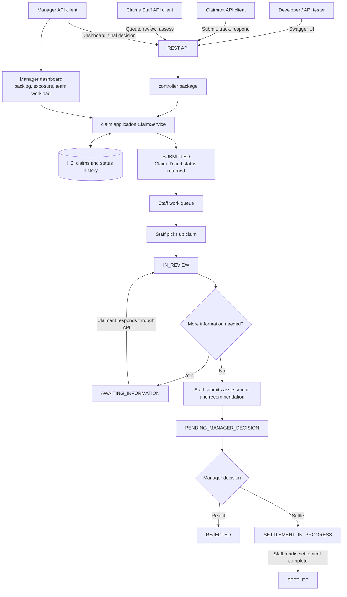
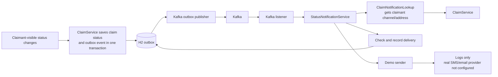

# Claims Management Application Flow

The diagrams below show the claim lifecycle and the asynchronous claimant-status notification path. Swagger UI is used to verify the REST APIs; it is not a claimant-facing frontend.

## Claim workflow

## Status notification path

## Notes

- Initial `SUBMITTED` status is returned in the API response; it does not produce a separate notification.
- Later claimant-visible status changes are written to the outbox in the same transaction as the claim update.
- Internal edits such as staff assignment or notes do not notify claimants.
- Kafka events contain the claim reference and new status, not claim details or contact information.
- The current notification sender is a demo adapter and does not send real SMS or email.
