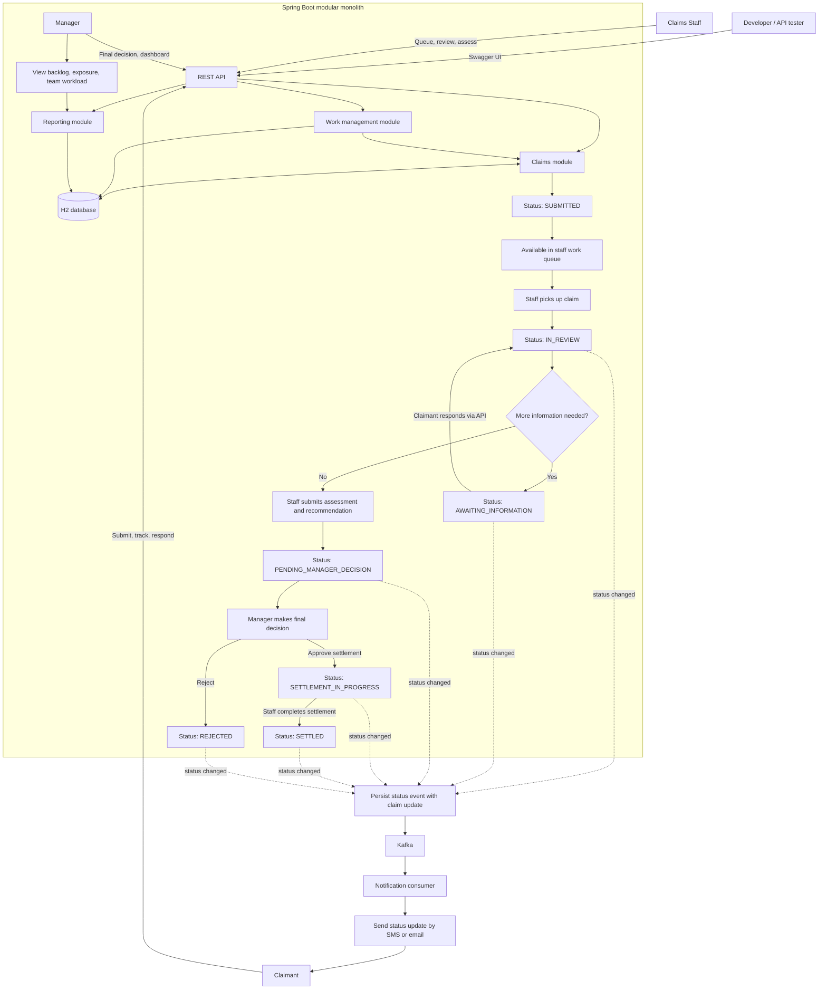

# Claims Management Flow

## Flow notes

- Claim submission returns the claim reference and `SUBMITTED` status in the API response; that initial status is not sent as a separate notification.
- Staff can pick up and review a claim, request more information, and submit an assessment recommendation.
- The manager makes the final settlement or rejection decision. Staff can then complete an approved settlement.
- Notifications are queued only when a claimant-visible status changes. Internal edits such as staff assignment or notes do not notify claimants.
- Kafka events carry the claim reference and new status, not claim details or contact information.
- Swagger UI is for API verification; it is not a claimant-facing frontend.

The status names and workflow are a first-pass design and can be amended as business rules are clarified.
